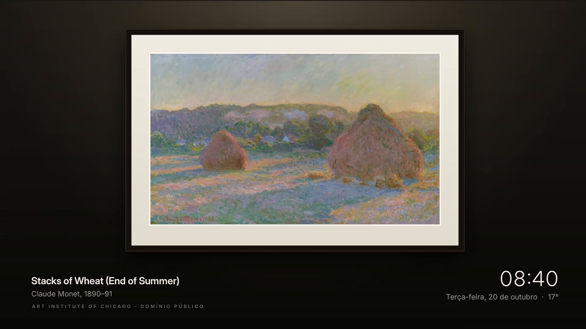

<div align="center">


# Marquise

**Uma tela inicial sem anúncios para Google TV, feita de pôsteres e montada em volta da sua biblioteca Jellyfin.**

O que acabou de chegar no seu servidor, logo na frente. Seus apps, nas cores deles. Um botão para voltar.

[Instalar](#instalar) · [Configurações](#configurações) · [Voltar ao original](#voltar-ao-original) · [Outras TVs](#outras-tvs) · [English](README.md)


</div>

## O que você ganha

- **Sua biblioteca, não um feed de propaganda.** Seis pôsteres do que acabou de entrar no seu Jellyfin, com ano, nota
  e classificação indicativa, mudando a cada meia hora. Filmes e Séries têm abas próprias.
- **Um clique para assistir.** Escolha um pôster e ele abre o filme ou a série no app do Jellyfin.
- **Seus apps, nas cores deles, do seu jeito.** Segure OK num app para mover ou tirar da fileira; segure OK em qualquer
  app de Todos os Apps para adicionar. A TV aberta pode ser um deles.
- **Hora e clima** no topo, e a previsão das próximas horas com um clique para baixo.
- **Claro de dia, escuro à noite**, seguindo o pôr do sol de verdade da sua cidade.
- **Tela de descanso Galeria**: pinturas em domínio público do Art Institute of Chicago, emolduradas, uma por vez, com
  a hora; à noite, ela escurece.
- **Sem Jellyfin? TMDB.** O que está em alta no seu país nos streamings que você tem (Netflix, Prime Video, Disney+,
  Max, Globoplay…), cada um abrindo no seu app. Com a sua chave grátis do TMDB, digitada uma vez na TV.
- **Atualiza pela TV.** Quando sai uma versão nova, as configurações avisam, e o OK instala.
- **Sem anúncios, sem fileiras patrocinadas, sem rastreamento.** Conversa com o seu Jellyfin (ou o TMDB), com o Open-Meteo
  para o clima, com o Art Institute of Chicago para as pinturas e com o GitHub para atualizações, e nada mais.
- **Seguro.** Sem root. Nada é desinstalado. *Original* traz de volta o Início de fábrica, e um vigia faz isso sozinho
  se o Marquise travar.

<p align="center"></p>

## Requisitos

- Uma **Google TV ou Android TV com Android 12 ou mais novo** (TCL, Sony, Hisense, Philips, Chromecast com Google TV,
  Google TV Streamer, onn 4K, NVIDIA Shield…). Samsung, LG ou outra marca: ligue um Google TV Streamer nela.
- Um **servidor Jellyfin** que a TV alcance, e o **app do Jellyfin** na TV.

Não precisa de computador.

## Instalar

Uns cinco minutos, tudo pelo controle. O passo a passo com imagens, para mandar para quem nunca fez isso:
**[vitoramaral10.github.io/marquise](https://vitoramaral10.github.io/marquise)**.

1. **Ative a Depuração USB.** *Configurações → Sistema → Sobre →* aperte 7 vezes em *Build do Android TV OS*. Depois
   *Configurações → Sistema → Opções do desenvolvedor →* ative **Depuração USB**. (O Marquise usa isso para trocar o
   Início e desligar os apps de propaganda; o Android não tem outro caminho.)
2. **Instale o Downloader** pela Play Store (da AFTVnews). Abra e permita que ele instale apps quando pedir.
3. **No Downloader, digite o código** `9141955` e instale (ou digite `vitoramaral10.github.io/marquise` e aperte
   *Baixar o Marquise*).
4. **Abra o Marquise.** Uma configuração rápida pergunta de onde vêm os filmes e séries: o **TMDB** (em alta nos seus
   streamings, com a sua chave grátis) ou o seu **Jellyfin**, que ela acha na rede e onde entra por **Quick Connect**
   (um código que você aprova no celular) ou com usuário e senha. Depois, sua cidade. Depois é só **Ativar o Marquise** e aceitar o aviso de depuração da TV (marque *Sempre permitir*).

Atualizações: as configurações do Marquise mostram *Atualização — Versão X disponível*; aperte OK e confirme (na
primeira vez, o Android pede para permitir que o Marquise instale apps). Instalar o APK novo pelo Downloader, por cima
do antigo, também funciona.

### Compilar você mesmo

Precisa de JDK 17+, das ferramentas de linha de comando do Android SDK (build-tools 34, platform android-34) e do `adb`:

```bash
git clone https://github.com/vitoramaral10/marquise && cd marquise
./build.sh                     # a primeira vez cria o config.properties
adb connect 192.168.1.50:5555  # o IP da sua TV; aceite o aviso na TV
adb install -r marquise.apk
```

O `config.properties` pode deixar a configuração pronta (servidor, chave de API, cidade) e define o que só o build
define: a fileira padrão, o idioma e os apps extras para desligar. **Guarde o `marquise.keystore`**: as atualizações
precisam da mesma chave.

> Prefere que uma IA faça? Abra a pasta no [Claude Code](https://claude.com/claude-code) e diga *"Instale o Marquise na
> minha TV em 192.168.1.50. Meu Jellyfin está em http://192.168.1.10:8096. Moro em Curitiba."* O
> [CLAUDE.md](CLAUDE.md) explica o caminho.

## Configurações

**Na TV**, nas configurações do Marquise (o ícone dele, ou a engrenagem no topo do Início): servidor e conta do
de onde vêm os pôsteres (*Títulos*: seu servidor e conta do Jellyfin, ou o TMDB com sua chave e país), sua cidade, o
Início (Marquise ou Original), uma prévia da tela de descanso e, quando houver, a versão nova.

**A fileira de apps:** segure OK num app da fileira para *Mover* (← → e OK), *Remover do Início* ou *Restaurar fileira
padrão*, e segure OK em qualquer app de *Todos os Apps* para *Adicionar ao Início* (até 8). Apps que você instalou
também têm *Desinstalar*, que abre a confirmação do próprio Android. Tudo isso fica salvo na TV e continua depois das
atualizações.

**Ao compilar**, o `config.properties` (criado no primeiro build, fora do git):

| Chave | O que faz | Padrão |
|---|---|---|
| `jellyfin_url`, `jellyfin_key`, `jellyfin_user` | Deixam servidor, chave de API e usuário prontos (pula a configuração) | vazio |
| `shelf` | A fileira padrão: `jellyfin`, `live`, `youtube`, `netflix`, `prime`, `disney`, `max`, `appletv`, `hulu`, `paramount`, `peacock`, `globoplay`, `spotify`, `f1tv` | `jellyfin,live,youtube,netflix,prime,disney,max,spotify` |
| `latitude`, `longitude`, `city` | Deixam a cidade pronta | Nova York |
| `language` | `auto` (segue a TV), `en` ou `pt` | `auto` |
| `temperature` | `C`, `F` ou `auto` | `auto` |
| `disable_assistant` | Também desliga o Google Assistente (o botão do microfone para) | `false` |
| `extra_disable` | Mais pacotes para desligar enquanto o Marquise estiver ligado, separados por vírgula | vazio |

## Voltar ao original

Na TV: *Marquise → Home Screen → Original*. O Início de fábrica, a tela de descanso e todos os apps voltam exatamente
como estavam. Se o Início do Marquise travar três vezes em cinco minutos, ele volta sozinho.

Para remover de vez, primeiro mude para *Original* e depois desinstale o Marquise (*Configurações → Apps*).

## O que ele muda

- Vira a tela inicial e a tela de descanso.
- Desliga, sem desinstalar:
  - o Início e a tela de descanso de fábrica;
  - o Início de recuperação do Google TV, Play Games, YouTube Music, Play Auto Installs (instalação de apps
    patrocinados) e os relatórios de feedback;
  - nas TVs TCL, o TCL Channel, mensagens, modo demonstração, menu de hotel, manuais, espelhamento, logs e apps de
    propaganda;
  - o Google Assistente, só com `disable_assistant=true`, e o que você listar em `extra_disable`.
- Imagem, som, entradas, pareamento do controle, serviços do Google e a Play Store ficam numa lista protegida,
  conferida antes de cada mudança.

Em algumas TVs os botões de atalho do controle pertencem ao Início de fábrica (na TCL: Netflix, YouTube, Prime), então
ficam parados enquanto o Marquise estiver ligado.

## Outras TVs

O Marquise vem com as listas para Google TV e TCL. Para outra marca, acrescente os apps de propaganda dela em `DEBLOAT`
e as peças de sistema em `PROTECTED` no [`HomeMode.java`](app/src/br/dev/vitormelo/marquise/HomeMode.java), e o app de
TV ao vivo em `LIVE_TV_APPS` no [`HomeApps.java`](app/src/br/dev/vitormelo/marquise/HomeApps.java). O
[CLAUDE.md](CLAUDE.md) lista os comandos `adb` de leitura que mostram o que sua TV tem. Pull requests com outras marcas
são muito bem-vindos.

## Como funciona

- **Um app Android simples em Java, sem Gradle e sem bibliotecas.** O [`build.sh`](build.sh) roda aapt2 → javac → d8 →
  zipalign → apksigner e gera um APK de ~1 MB.
- **Ele usa o ADB da própria TV, de dentro da TV.** O app se conecta a `127.0.0.1:5555` com a própria chave e roda os
  mesmos comandos que você rodaria: `cmd package set-home-activity`, `settings put secure screensaver_components`,
  `pm disable-user`. Nada fica escutando na rede.
- **Desenhado à mão num único Canvas**, para manter 60 fps no chip modesto da TV.
- **Uma rede de segurança**: um vigia num processo separado devolve o Início de fábrica depois de três travamentos em
  cinco minutos, e uma conferência no boot mantém sua escolha depois de atualizações da TV.

## Privacidade

Sem contas, sem analytics, sem rastreamento. O Marquise conversa com o seu Jellyfin (com a chave que você definir) ou
com o TMDB (com a sua própria chave), e com o Open-Meteo (com as coordenadas que você definir); a tela de descanso
busca pinturas no artic.edu, e as configurações consultam o GitHub atrás de versão nova. Suas configurações ficam no
seu computador e na sua TV.

## Créditos

- Clima por [Open-Meteo.com](https://open-meteo.com/) (CC BY 4.0).
- Dados de filmes e séries do [TMDB](https://www.themoviedb.org/), disponibilidade nos streamings pelo JustWatch. Este
  produto usa a API do TMDB, mas não é endossado nem certificado pelo TMDB.
- Pinturas da tela de descanso: [Art Institute of Chicago](https://www.artic.edu/open-access), domínio público (CC0).
- Ícones: [Material Symbols](https://fonts.google.com/icons) (Apache 2.0). Fonte: [Inter](https://rsms.me/inter/)
  (SIL OFL 1.1).
- Sem vínculo com Jellyfin, Google, TCL ou qualquer serviço de streaming. Nomes e logos de apps pertencem aos donos.

## Licença

[GPL-3.0](LICENSE) (ou versão posterior). Use, modifique e compartilhe; se você distribuir uma versão modificada, o
código dela precisa ser publicado sob a mesma licença. Melhorias são bem-vindas de volta como pull requests. Os avisos
de terceiros estão em [NOTICE](NOTICE).
